# Curio: STEM learning platform

Curio is a full-stack web application for learning maths, physics, chemistry
and computer science through short interactive lessons. Learners follow a
course path, answer questions, earn XP and compete in weekly leagues.
Instructors use the **Lesson Studio** to create, view, edit and delete
lessons, which are stored in MongoDB.

**Stack:** React 18 + Vite + Tailwind CSS (frontend) · Node.js + Express 5
(backend) · MongoDB + Mongoose · JWT authentication · Zod validation.

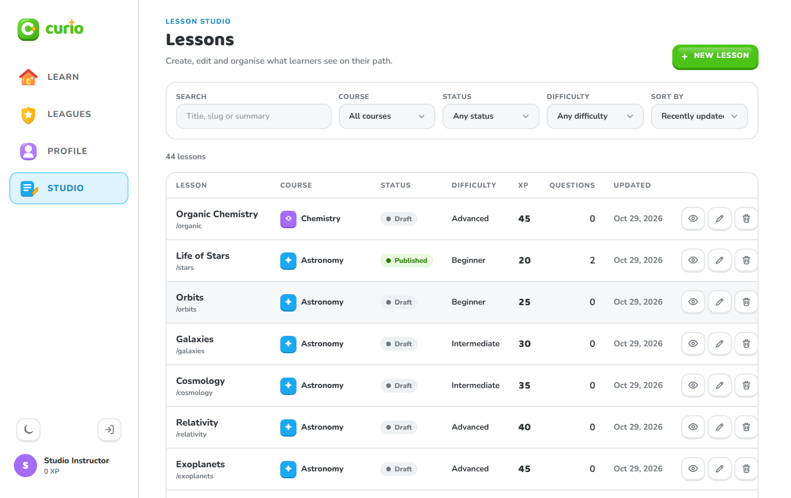

## Features

| Area | What it does |
|---|---|
| **Create** | Instructors add lessons through a form: title, auto-generated URL slug, course, position, XP, difficulty, duration, publish toggle, and a question editor (multiple choice, number answer, put-in-order). Learners create accounts through the sign-up form. |
| **Read** | Studio list with **search** (title/slug/summary), **filters** (course, status, difficulty), **sorting** (updated, title, XP, course order) and **pagination**. Filters are kept in the URL. A lesson **detail page** shows its questions, metadata and learner statistics. Learners see the catalog, their path and lessons. |
| **Update** | Edit any lesson with the same form, pre-filled. Learners edit their profile and course preferences. |
| **Delete** | Delete a lesson after a confirmation dialog; its attempts and learner progress are removed with it. Learners can delete their account after re-entering their password. |
| **Validation** | Every form is checked in the browser first (messages appear next to each field), and every request is validated again on the server with Zod and Mongoose. Server errors such as a duplicate slug or email are shown on the matching field. |
| **Roles** | `learner` (default) and `instructor`. The Studio pages and `/api/studio` endpoints are only available to instructors. |
| **Responsive UI** | Sidebar on desktop, icon rail on tablets, bottom navigation on phones; light and dark themes. |

## Project structure

```
.
├── backend/                  Express REST API
│   ├── src/
│   │   ├── config/           environment variables, DB connection, DNS
│   │   ├── models/           Mongoose schemas: User, Course, Lesson, Attempt
│   │   ├── validators/       Zod request schemas
│   │   ├── middleware/       auth (JWT, roles), validate, error handler
│   │   ├── controllers/      request handlers, one file per resource
│   │   ├── routes/           URL → middleware → controller
│   │   ├── services/         business logic (progress/XP, weekly leagues)
│   │   ├── utils/            ApiError, slug helpers, public user view
│   │   ├── seed/             starter catalog + seed script
│   │   ├── app.js            builds the Express app
│   │   └── server.js         connects to MongoDB and starts listening
│   └── tests/                API integration tests (node:test + supertest)
├── frontend/                 React single-page app
│   ├── src/
│   │   ├── api/              axios client + one module per resource
│   │   ├── components/
│   │   │   ├── common/       Modal, ConfirmDialog, FormField, Alert, …
│   │   │   ├── layout/       Navbar, AuthLayout
│   │   │   ├── course/       course path, course picker
│   │   │   ├── lesson/       question player, interactive labs
│   │   │   ├── gamification/ streak, XP, hearts, league badges
│   │   │   └── studio/       Lesson Studio parts (question editor, chips, dialogs)
│   │   ├── context/          AuthContext, ThemeContext
│   │   ├── lib/              validation rules, studio helpers, leagues, sound
│   │   ├── pages/            one component per route (pages/studio for CRUD)
│   │   └── routes/           ProtectedRoute (login and role checks)
│   └── tests/                Playwright UI tests
├── docs/                     database design (ERD), UI guide, screenshots
├── scripts/                  screenshot capture script
└── package.json              npm workspaces: runs both apps together
```

## Setup

### Requirements

- Node.js 20 or newer (tested with Node 24)
- A MongoDB database: a free [MongoDB Atlas](https://www.mongodb.com/atlas)
  cluster, or MongoDB Community Server running locally

### Steps

```bash
# 1. Install dependencies for both apps (from the project root)
npm install

# 2. Create the backend configuration
cp backend/.env.example backend/.env
#    then edit backend/.env: set MONGODB_URI and JWT_SECRET

# 3. Start the API (port 4000) and the web app (port 5173) together
npm run dev
```

Open <http://localhost:5173>.

On first start the API fills an empty database with 8 courses and 44
lessons, all with questions, and creates the instructor account from
`backend/.env`. On later starts, any seeded lesson still saved as an empty
draft gets its questions from the catalog; lessons an instructor has edited are
left alone.

### Environment variables (`backend/.env`)

| Variable | Required | Description |
|---|---|---|
| `MONGODB_URI` | yes | MongoDB connection string |
| `JWT_SECRET` | yes | Long random string used to sign login tokens |
| `PORT` | no | API port (default `4000`) |
| `CLIENT_ORIGIN` | no | Allowed browser origin for CORS (default `http://localhost:5173`) |
| `INSTRUCTOR_NAME`, `INSTRUCTOR_EMAIL`, `INSTRUCTOR_PASSWORD` | no | Instructor account created at start-up |
| `DNS_SERVERS` | no | Comma-separated DNS servers, if your network blocks Atlas SRV lookups (e.g. `1.1.1.1,1.0.0.1`) |

### Accounts for trying it out

| Role | How |
|---|---|
| Instructor | Log in with `INSTRUCTOR_EMAIL` / `INSTRUCTOR_PASSWORD` from `backend/.env` (example file: `instructor@curio.dev` / `Instructor123`). You land in the Lesson Studio. |
| Learner | Create an account on the sign-up page. |

### Scripts (run from the project root)

| Command | Does |
|---|---|
| `npm run dev` | Starts API and web app with auto-reload |
| `npm run build` | Builds the frontend into `frontend/dist` |
| `npm start` | Starts the API only (production mode) |
| `npm run seed` | Seeds an empty database and creates the instructor |
| `npm run seed:reset` | Deletes all courses, lessons and attempts, then reseeds |
| `npm test` | Runs the API tests against an in-memory MongoDB |
| `npm run test:ui` | Runs the Playwright UI tests (uses Microsoft Edge on Windows) |

## Database design

Four collections: `users`, `courses`, `lessons` and `attempts`. Lessons
reference their course, attempts reference the user, lesson and course, and
questions and progress are embedded. See **[docs/DATABASE.md](docs/DATABASE.md)**
for the ERD, keys, indexes and integrity rules.

## REST API

All endpoints are under `/api`. Requests and responses use JSON. Protected
endpoints need an `Authorization: Bearer <token>` header. Errors always look
like `{ "message": "...", "errors": { "field": "message" } }`.

| Method | Endpoint | Auth | Description |
|---|---|---|---|
| POST | `/auth/signup` | – | Create a learner account → `{ token, user }` |
| POST | `/auth/login` | – | Log in → `{ token, user }` |
| GET | `/users/me` | user | Current user |
| PATCH | `/users/me` | user | Update name, bio |
| DELETE | `/users/me` | user | Delete account (body: `{ password }`) |
| PUT | `/users/me/course-profiles/:courseSlug` | user | Save goal, level and pace for a course |
| PUT | `/users/me/active-course` | user | Choose the active course |
| GET | `/courses` | optional | Published courses with each learner's path status and a preview of every lesson (summary, steps, minutes, XP) |
| GET | `/lessons/:slug` | – | A published lesson's questions |
| POST | `/lessons/:slug/complete` | user | Submit a result; awards XP, updates streak and league |
| GET | `/leaderboard` | user | This week's league standings |
| GET | `/leagues` | user | League tiers and current league |
| POST | `/leagues/result/seen` | user | Dismiss last week's result |
| GET | `/studio/courses` | instructor | All courses with lesson counts |
| GET | `/studio/lessons` | instructor | List lessons. Query: `search`, `course`, `status` (`published`/`draft`), `difficulty`, `sort` (`newest`, `oldest`, `title`, `-title`, `xp`, `-xp`, `order`), `page`, `limit` |
| POST | `/studio/lessons` | instructor | Create a lesson → `201` |
| GET | `/studio/lessons/:id` | instructor | One lesson with course, author and statistics |
| PUT | `/studio/lessons/:id` | instructor | Update a lesson |
| DELETE | `/studio/lessons/:id` | instructor | Delete a lesson and its attempts/progress |
| GET | `/health` | – | API and database status |

Status codes: `200` OK, `201` created, `204` deleted (account), `400`
validation error, `401` not logged in, `403` wrong role, `404` not found,
`409` duplicate slug/email, `429` too many login attempts, `500` server
error.

## Validation and error handling

- **Client side** (`frontend/src/lib/validation.js`): sign-up, login, profile
  and lesson forms are checked before sending; each message is shown under
  its field with `aria-invalid` set.
- **Server side** (`backend/src/validators`): Zod schemas validate every body
  and query string, including each nested question (e.g. a multiple-choice
  question needs 2–6 options and a valid correct answer). Mongoose schemas
  repeat the key rules as a last line of defence.
- **Errors** go through one handler (`backend/src/middleware/errorHandler.js`)
  that turns validation, duplicate-key, bad-id and unknown-route errors into
  clear JSON responses. The frontend shows loading, empty and error states
  with a retry button, and rate-limits login attempts.

## Testing

- `npm test`: 18 API tests covering sign-up/login validation, role checks,
  all four lesson CRUD operations (including search/filter/sort/pagination,
  nested-question validation, duplicate slugs and cascade delete), account
  update/delete, and migration of older data.
- `npm run test:ui`: 16 browser tests covering the learner screens, the Lesson
  Studio CRUD flow with validation messages, role redirects, and mobile
  layouts without horizontal overflow.

## Screenshots

| | |
|---|---|
| 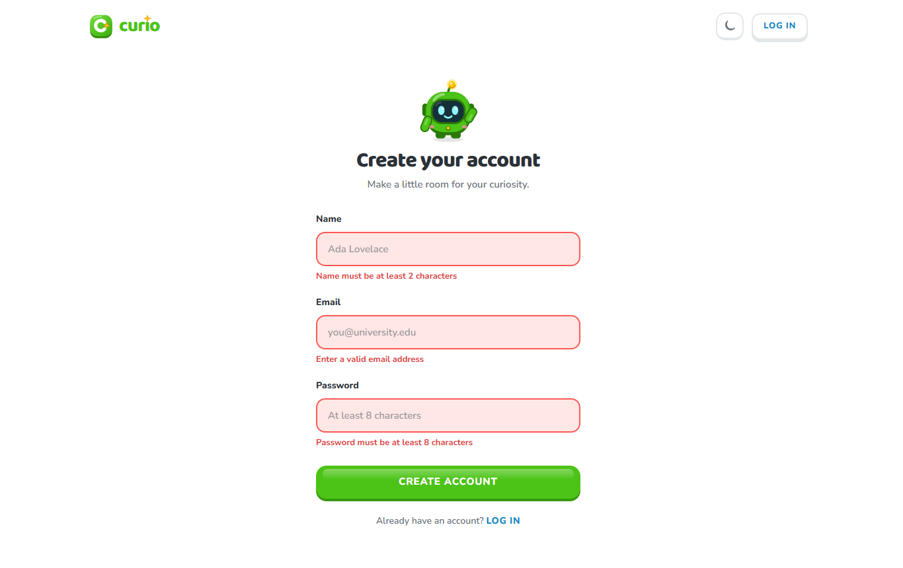 Sign-up with validation | 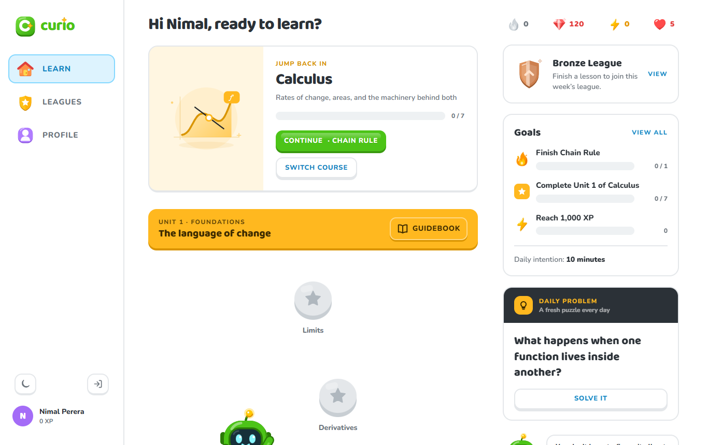 Learner dashboard |
| 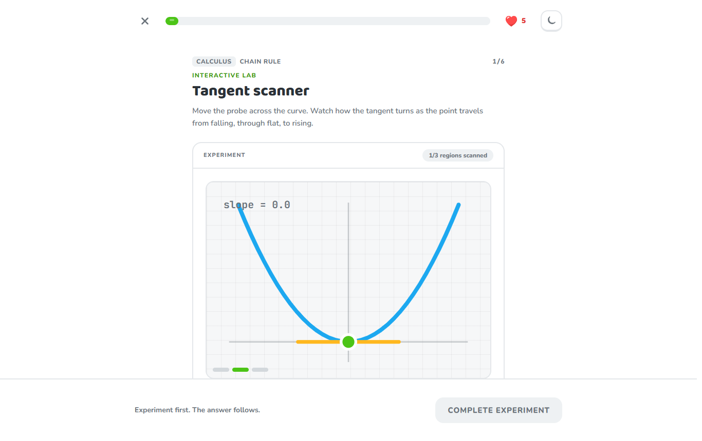 Interactive lesson | 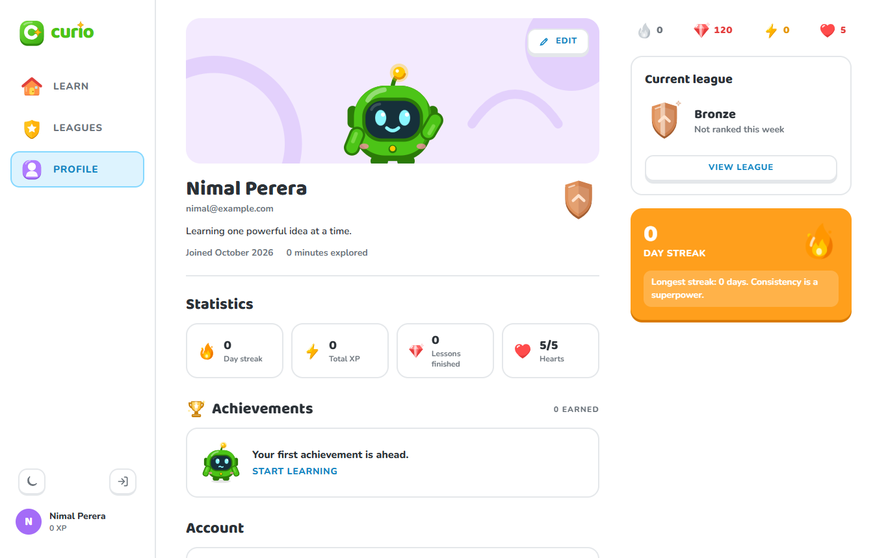 Profile and account |
|  Lesson Studio list | 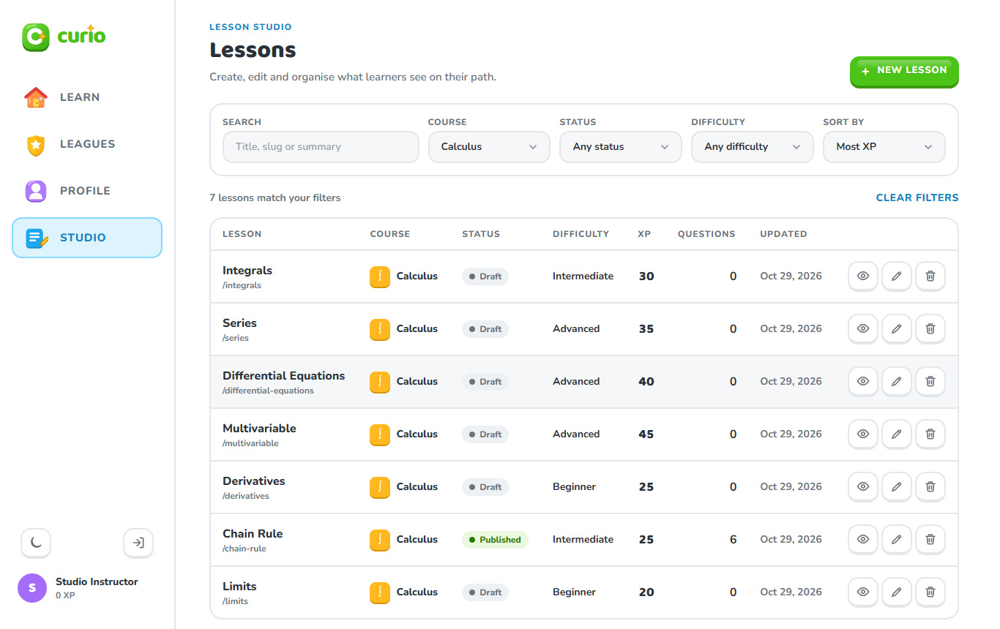 Filtered and sorted |
| 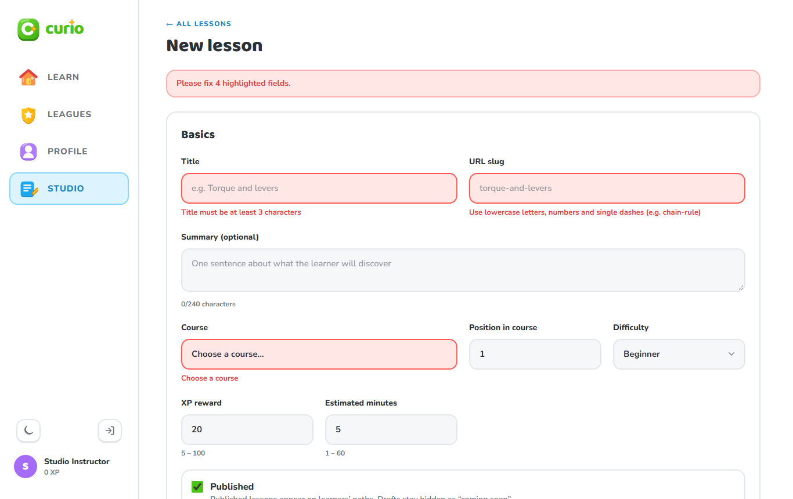 Create: validation | 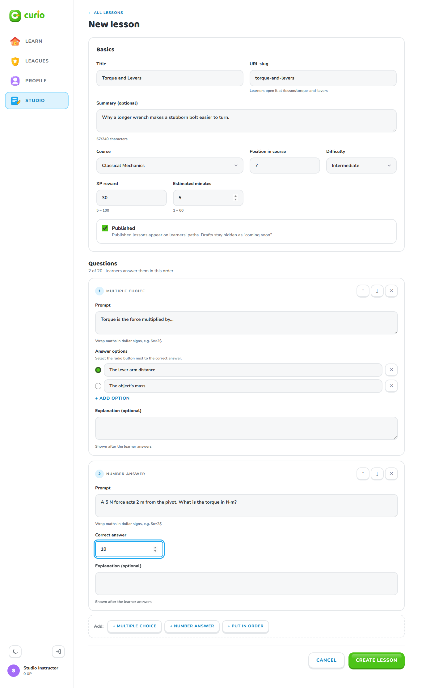 Create: filled form |
| 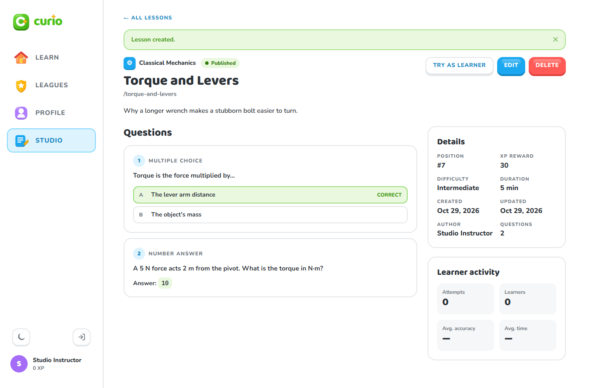 Lesson detail | 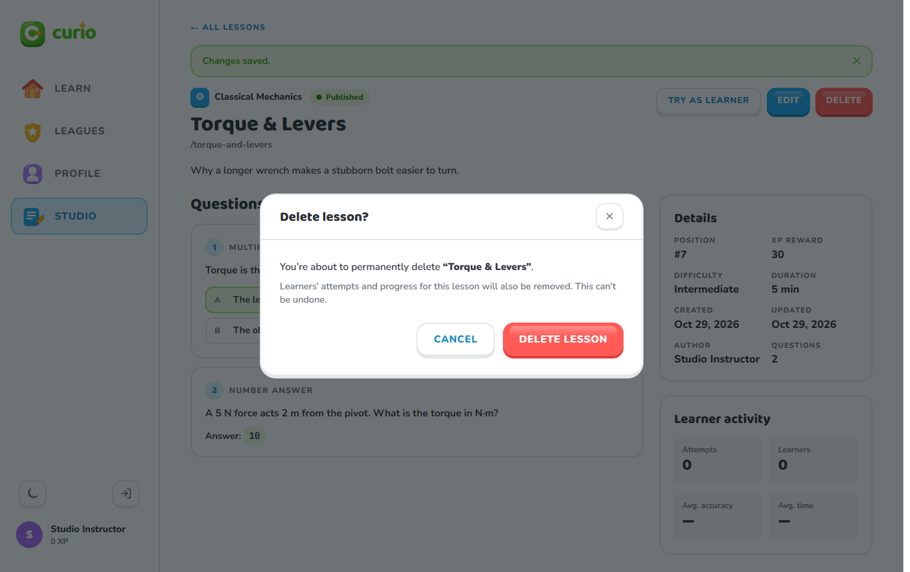 Delete confirmation |
| 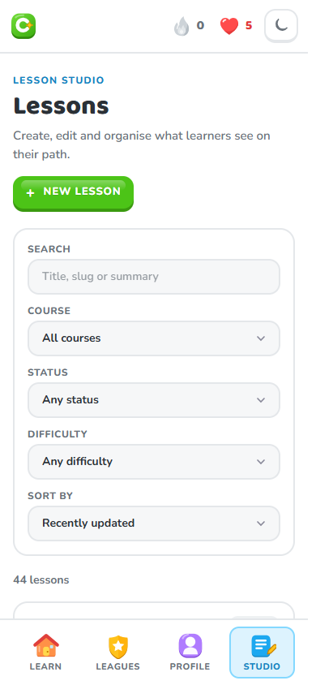 Mobile studio | 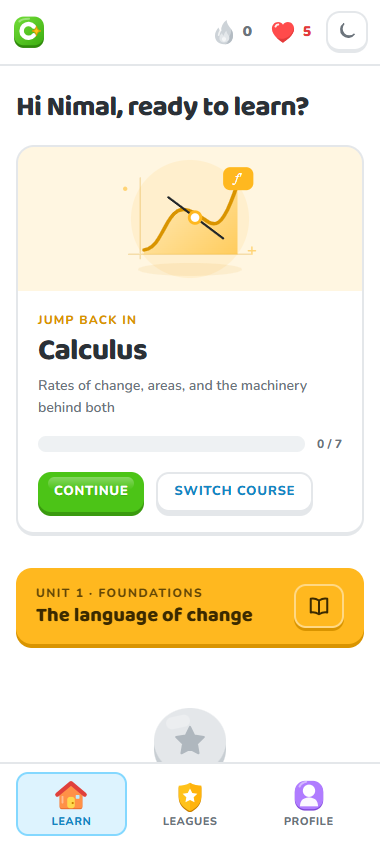 Mobile dashboard |

To regenerate the screenshots (runs the whole stack on a temporary in-memory
database): `node scripts/capture-screenshots.mjs`.
