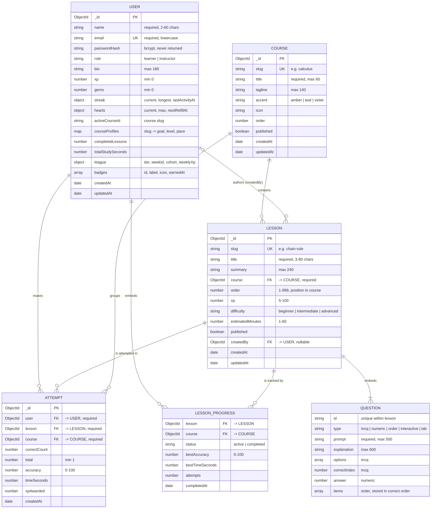

# Database design

Curio stores its data in MongoDB through Mongoose schemas
(`backend/src/models`). There are four collections. Data that only exists
inside a parent (lesson questions, a learner's progress and badges) is
embedded; data that is shared or grows without limit (courses, lessons,
attempts) lives in its own collection and is linked by `ObjectId` references.

## Entity relationship diagram

`QUESTION` and `LESSON_PROGRESS` are embedded sub-documents, not separate
collections. They are drawn as entities to show their structure.

## Collections

| Collection | Purpose | Primary key | Unique keys | Foreign keys |
|---|---|---|---|---|
| `users` | Accounts, game stats, preferences | `_id` | `email` | `lessonProgress[].lesson → lessons`, `lessonProgress[].course → courses` |
| `courses` | Subjects shown in the catalog | `_id` | `slug` | – |
| `lessons` | The main CRUD entity: ordered steps of a course | `_id` | `slug` | `course → courses`, `createdBy → users` |
| `attempts` | One row per finished lesson run (history and stats) | `_id` | – | `user → users`, `lesson → lessons`, `course → courses` |

## Relationships

- **Course 1 : N Lesson.** Every lesson must reference an existing course
  (checked by the API before saving). A course's learning path is the query
  `Lesson.find({ course }).sort({ order: 1 })`, so it is never copied or out of
  date.
- **User 1 : N Attempt** and **Lesson 1 : N Attempt.** Attempts are kept
  separately because they grow without limit. They are used for the per-lesson
  statistics in the Lesson Studio (attempts, learners, average accuracy and
  time).
- **User 1 : N LessonProgress (embedded).** One entry per lesson a learner has
  finished, read on every dashboard load, so it is embedded in the user.
- **Lesson 1 : N Question (embedded).** Questions have no meaning outside their
  lesson and are always loaded together with it.
- **User 0..1 : N Lesson (author).** `createdBy` records which instructor
  created a lesson. Seeded lessons have no author.

## Keys and indexes

| Collection | Index | Why |
|---|---|---|
| users | `{ email: 1 }` unique | Login lookup, no duplicate accounts |
| users | `{ league.weekId, league.tier, league.cohort, league.weeklyXp: -1 }` | Weekly leaderboard query |
| courses | `{ slug: 1 }` unique | Public URLs use slugs |
| courses | `{ published: 1, order: 1 }` | Catalog listing |
| lessons | `{ slug: 1 }` unique | `/lesson/:slug` lookups, no duplicate URLs |
| lessons | `{ course: 1, order: 1 }` | Building a course path; filtering by course |
| lessons | `{ published: 1, updatedAt: -1 }` | Studio status filter and default sort |
| attempts | `{ user: 1, createdAt: -1 }` | A learner's history |
| attempts | `{ lesson: 1 }` | Lesson statistics and cascade delete |

## Data integrity rules

- Schema validation: required fields, enums, string lengths and number ranges
  are declared in each schema, so invalid data cannot be saved even if API
  validation were bypassed.
- A **published** lesson must contain at least one question (schema validator
  plus API check).
- **Deleting a lesson** also deletes its attempts and removes it from every
  learner's `lessonProgress`, so no reference is left pointing at a missing
  lesson.
- **Deleting an account** requires the password, deletes the user's attempts,
  and sets `createdBy` to `null` on lessons they authored.
- Passwords are stored only as bcrypt hashes (`select: false`, so they are
  never returned by default queries).
